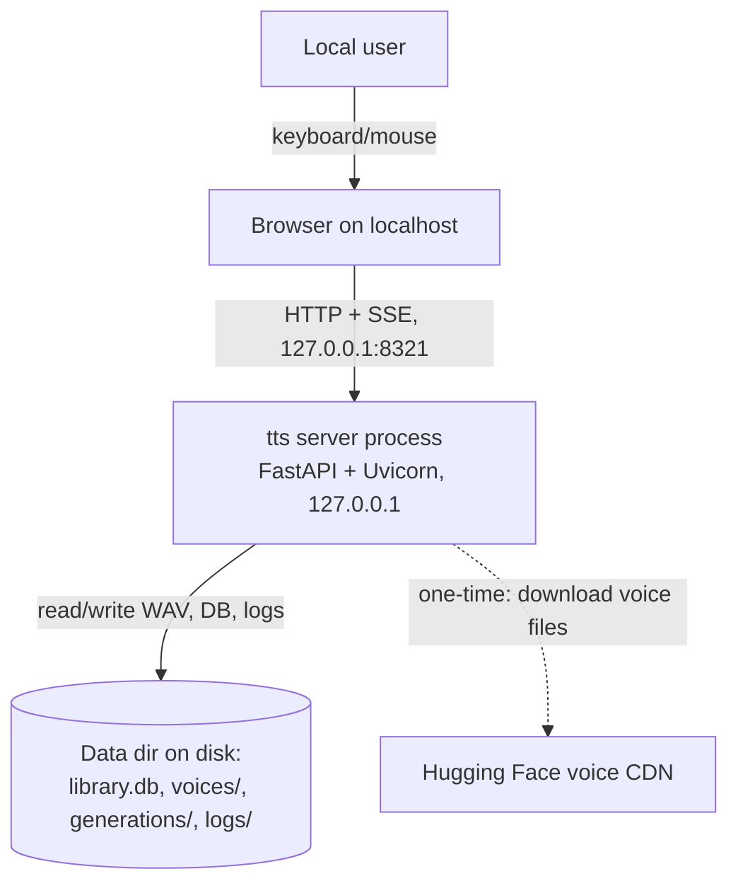
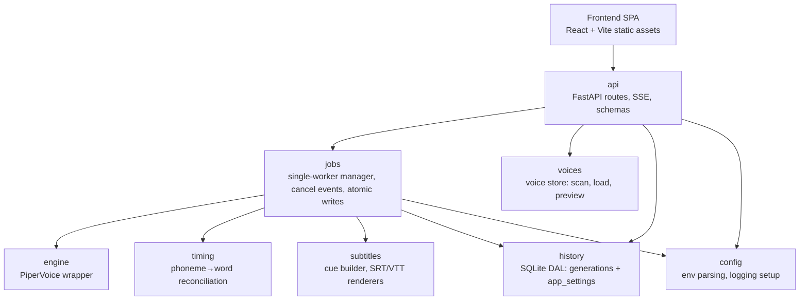
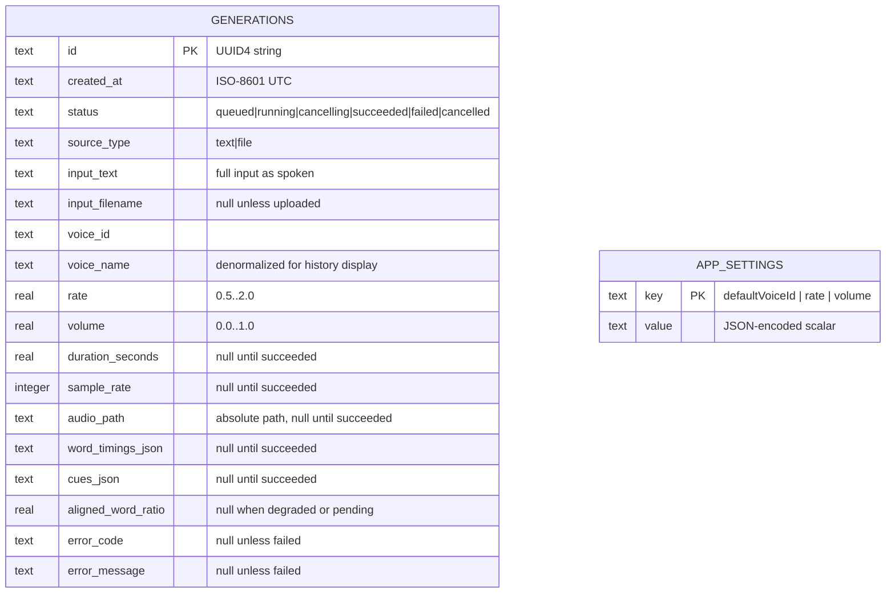
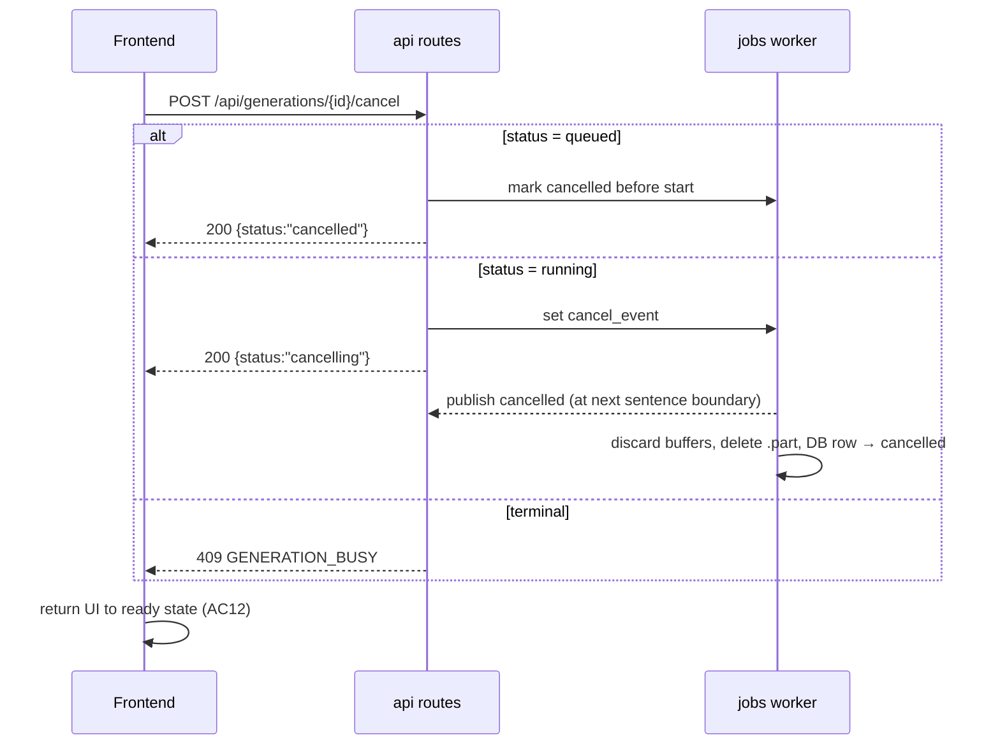

# ARCHITECTURE — tts

Source of truth for WHAT: `docs/PRD.md`. This document decides HOW. It is written for AI coding agents implementing the project without access to the author. Contracts in Section 9 are binding.

---

## 1. Overview

tts is a locally hosted single-process web application that converts typed, pasted, or uploaded plain text into spoken audio using offline neural voices (Piper), produces word-level timestamps aligned to the generated audio, derives sentence-level subtitle cues, plays the audio in the browser with live word highlighting and seek-to-word, exports WAV audio plus SRT/WebVTT subtitles, and keeps a bounded, deletable generation history. After installation (one voice download), the entire workflow runs with zero outbound network traffic.

**Goals (from PRD §3):** offline text→audio in one place, automatic word/sentence timestamps, instant quality verification via synchronized playback, privacy by locality, minutes-to-first-audio for a non-technical user.

**Non-goals (from PRD §7 out-of-scope):** HTTP API and CLI interfaces for third parties (the app's own HTTP endpoints and `tts` startup command are internal, not products), cloud TTS, audio format options, hand-editing of cue boundaries, batch conversion, non-plain-text documents, multi-user/auth/hosted deployment, video rendering, voice installation management.

**Architectural principles:**

- One Python process, one SQLite file, one thread pool of size 1. No queues, containers, or services.
- Privacy by construction: the server binds to 127.0.0.1 only; nothing else is network-reachable.
- Partial output is never success: audio is written atomically (`.part` → rename) and the database row is marked `succeeded` only after the rename.
- All cross-boundary contracts (HTTP, SSE, JSON fields, DB schema) are pinned in Sections 8–9 and owned by exactly one task each (Section 14).
- Degrade honestly: if word-timing reconciliation fails for a sentence, timings are flagged `aligned=false`, never fabricated (FR-05).

---

## 2. Requirements Traceability

| ID | Requirement | Satisfied by | Sections |
|---|---|---|---|
| FR-01 | Text input (type/paste/upload .txt, validation, length warning) | api (uploads+generations routes), frontend InputPanel | 7, 9, 12, 14 (T2.1, T3.1) |
| FR-02 | Voice selection (list, preview, default, no-voice guidance) | voices store, api voices routes, frontend VoicePanel | 7, 9, 10, 14 (T1.1, T2.1, T3.1) |
| FR-03 | Speech settings (rate, volume) | engine SynthesisConfig mapping, api validation, frontend sliders | 7, 9, 14 (T1.2, T2.2, T3.1). **Partial: pitch omitted — deviation D-1 in §3** |
| FR-04 | Audio generation (progress, cancel, failure handling) | jobs manager, api generations routes + SSE, frontend GenerateBar | 7, 9, 10, 14 (T1.6, T2.2, T3.1) |
| FR-05 | Word + sentence timestamps, honest alignment | engine alignments, timing reconcile, subtitles cues | 7, 8, 9, 14 (T1.2, T1.3, T1.4) |
| FR-06 | Synchronized playback, highlight, seek-to-word | frontend PlaybackPanel + usePlayback hook | 12, 14 (T3.2) |
| FR-07 | Download audio + SRT/VTT, named exports, retry without regen | api media endpoints, frontend DownloadBar | 9, 12, 14 (T2.2, T3.2) |
| FR-08 | Bounded history with restore and delete | history DAL (DB), api routes, frontend HistoryPanel | 7, 8, 9, 12, 14 (T1.5, T2.2, T2.3, T3.3) |
| NFR-01 | Offline + privacy | 127.0.0.1 bind, local voice store, no telemetry; E2E network-interception test | 11, 13, 15 (T5.1) |
| NFR-02 | Performance, responsive UI during synthesis | background job thread + SSE, chunked progress; targets measured T5.3 | 10, 11, 14 (T1.6, T5.3) |
| NFR-03 | Data integrity (atomic audio, consistent timings) | atomic write protocol, deterministic synthesis, DB status gating | 7, 10, 11 (T1.6) |
| NFR-04 | Usability, plain-language errors, keyboard access | frontend error banner + validation copy, a11y pass | 11, 12, 14 (T3.4→T4.2, T4.2) |
| NFR-05 | Reliability (failure never corrupts history) | DAL transaction discipline, eviction excludes active rows | 8, 11 (T1.5) |
| NFR-06 | Observability (local diagnostics) | structured logging to rotating file, generation events logged | 11 (T0.2, T4.3) |
| NFR-07 | Portability (Win/macOS/Linux) | piper-tts wheels + pure-Python stack; platforms stated in user docs | 5, 13 (T5.2) |

---

## 3. Assumptions and Open Questions

**Deviations from the PRD (explicit, user-approved):**

- **D-1 — Pitch control omitted.** Piper exposes no pitch parameter and OS-voice engines were rejected (§18 ADR-1). The API, UI, and DB have no pitch field. FR-03 is satisfied for rate and volume only. The PRD should be amended to move pitch to out-of-scope; until then this document governs. Impact if later required: add a DSP pitch-shift stage between engine and file write (isolated change in `engine/` + one API field).

**Assumptions:**

1. **A-1 — "Voices available on the user's machine" means the app's local voice store.** Voices are Piper voice files under `TTS_DATA_DIR/voices/`, installed via first-run auto-download of one default voice and via the `tts add-voice <name>` command (thin wrapper over `piper.download_voices`). Rationale: cross-platform reliability and exact word timings; still offline after install. Impact if wrong: none for MVP; OS voices could be added as a second engine behind the same interface.
2. **A-2 — Audio format is fixed:** 16-bit PCM mono WAV at the voice's sample rate (typically 22050 Hz). PRD forbids format options. Impact if wrong: WAV is universally playable; risk is file size only (§17 R5).
3. **A-3 — Defaults pending PRD's "establish during initial testing" are pre-set and env-overridable:** max input 50,000 chars (`TTS_MAX_INPUT_CHARS`), history limit 20 entries (`TTS_HISTORY_LIMIT`), timing-tolerance target ±100 ms on word starts (measured and recorded in T5.3). Impact if wrong: all are one-line config changes.
4. **A-4 — Single user, no authentication.** The security boundary is loopback-only binding (§11). Impact if wrong: not a supported deployment anyway (PRD excludes hosted deployment).
5. **A-5 — First run may use the network once** to download the default voice (`en_US-lessac-medium`, ~63 MB). NFR-01's "usable without internet after installation" is honored: install + first-run setup are one-time online steps, documented. Impact if wrong: user offline at first run sees the no-voice guidance (FR-02) and can install later.
6. **A-6 — `README.md` is stale** ("Simple text-to-speech CLI"). Task T5.2 rewrites it; no architecture impact.

**Open Questions (each has a default so agents proceed without waiting):**

1. Should the PRD be amended for D-1 (pitch)? **Default: yes, add a "Known deviation" note to `docs/PRD.md` FR-03 in task T5.2.**
2. Final timing-tolerance number for AC7. **Default: ±100 ms on word starts, measured over ≥ 3 texts × ≥ 2 voices in T5.3; result recorded in the known-limitations doc.**
3. Should the default voice adapt to the OS language? **Default: no — always `en_US-lessac-medium`; the user can change the default in Settings, persisted via `PUT /api/settings`.**

---

## 4. System Context and High-Level Architecture

### 4.1 System context



The dashed link is the only outbound path and exists solely during installation/first run and explicit `tts add-voice` commands (A-5). During input → generate → play → export there is no outbound traffic (AC14).

### 4.2 Internal components



Dependency direction is strictly downward: `api → jobs → {engine, timing, subtitles, history}`, `api → voices`, everything may import `config` and `types`. No component imports `api`. No cycles.

### 4.3 End-to-end walkthrough (happy path)

1. User pastes text and clicks **Generate**. Frontend `POST /api/generations` with `{text, voiceId?, rate?, volume?}`; server validates (FR-01), creates a `queued` row, returns `202 {generationId, status}`.
2. Frontend opens `GET /api/generations/{id}/events` (SSE). The single worker thread picks up the job: `voices.load_voice(id)` → `engine.synthesize()` per sentence with `include_alignments=True` (FR-04).
3. After each sentence the worker emits `progress` SSE and checks the cancel event.
4. On completion, `timing.derive_word_timings()` maps per-phoneme sample counts to words (FR-05), `subtitles.build_cues()` derives sentence cues, audio is written atomically to `generations/{id}.wav`, and the DB row flips to `succeeded`. SSE emits `succeeded`.
5. Frontend fetches `GET /api/generations/{id}` (timings + cues) and `GET /api/generations/{id}/audio` as a blob, then plays with rAF-driven word highlighting and click-to-seek (FR-06). Download buttons fetch audio and `/subtitles?format=srt|vtt` (FR-07).

---

## 5. Technology Stack

| Layer | Choice | Version | Rationale |
|---|---|---|---|
| Language/runtime | Python | 3.12 (>=3.12,<3.13) | piper wheels support it; match dev and CI exactly |
| TTS engine | `piper-tts[alignment]` | 1.8.0 (exact) | maintained (OHF), wheels for Win/macOS/Linux, per-phoneme sample counts for exact timings; deps limited to onnxruntime |
| ONNX patching | `onnx` (via `alignment` extra) | >=1.17,<2 | in-memory `include_alignments=True` patching |
| ONNX runtime | `onnxruntime` (piper dep) | >=1,<2 | CPU inference |
| Numerics | `numpy` | >=2.0,<3 | PCM buffers; also a transitive dep |
| Web framework | `fastapi` | >=0.115,<1 | pydantic validation, SSE-friendly streaming responses |
| ASGI server | `uvicorn` (standard extra) | >=0.34,<1 | single-process serving of API + static SPA |
| Multipart parsing | `python-multipart` | >=0.0.9 | FastAPI file upload |
| Data validation | `pydantic` (fastapi dep) | >=2.9,<3 | request/response schemas shared with docs |
| Database | stdlib `sqlite3` | bundled (3.12) | one file, WAL, zero deps |
| String alignment | stdlib `difflib.SequenceMatcher` | bundled | phoneme→word reconciliation without adding diff-match-patch |
| Frontend framework | `react`, `react-dom` | 19.x | boring, huge ecosystem |
| Frontend build | `vite` + `@vitejs/plugin-react` | 7.x | dev proxy + static build bundled into the wheel |
| Frontend language | `typescript` | ~5.9 | strict mode |
| Frontend tests | `vitest` | 3.x | unit tests for highlight/cue/api-mock logic |
| E2E | `@playwright/test` | 1.x | full-flow tests incl. network-interception offline proof (AC14) |
| Backend tests | `pytest` | 8.x (+ `pytest-asyncio`, `httpx`) | unit + integration (ASGI via httpx) |
| Lint/format (py) | `ruff` | latest | lint + format in one tool |
| Typecheck (py) | `mypy` | latest | strict on `src/tts` |
| Lint/format (ts) | `eslint` 9 + `typescript-eslint` 8 + `eslint-plugin-react-hooks` 7 + `prettier` 3 | latest | standard React + TypeScript config; `no-explicit-any` enforced |
| Package/build | `hatchling` wheel; `pip`/`npm` lockfiles | — | wheel bundles `frontend/dist`; entry point `tts` |
| CI | GitHub Actions | — | lint → unit (ubuntu+windows) → integration+E2E (ubuntu, cached voice) |
| Auth | none | — | loopback-only binding is the boundary (A-4) |
| Hosting | user's machine, uvicorn on 127.0.0.1:8321 | — | PRD excludes hosted deployment |

**Rejected alternatives:** kokoro-onnx 0.6.x (better voice, but English-only + heavier G2P chain and fixed voice set); OS system voices via pyttsx3/SAPI (three platform code paths, word timings Windows-only); torchaudio/MMS forced aligners (adds ~2 GB torch for data piper already provides); whisper-based ASR alignment (transcription may differ from input text, violating FR-05's "matches the input text"); SQLAlchemy (DAL is 2 tables); Celery/Redis (single user, single worker); WebSocket (SSE is simpler, reconnect-safe for this event shape); React Router (single-page, one route); zustand (useReducer suffices); HTTP Range streaming (blob fetch of a local WAV is simpler and gives perfect seek).

Version policy: the table shows verified floors; `requirements.txt` / `package-lock.json` pin exact resolved versions and are updated only via the shared-file protocol (§14).

---

## 6. Repository Structure

```
tts/
├── ARCHITECTURE.md            # this document (contracts are binding)
├── README.md                  # rewritten in T5.2: install, platforms, usage, troubleshooting
├── docs/
│   └── PRD.md                 # source of truth for WHAT
├── pyproject.toml             # hatchling; deps; entry point tts=tts.__main__:main
├── requirements.txt           # exact-pinned runtime deps (generated from lock step)
├── requirements-dev.txt       # pytest, mypy, ruff, httpx, pytest-asyncio
├── .github/workflows/ci.yml   # lint → unit → integration → e2e
├── src/tts/
│   ├── __init__.py            # version string
│   ├── __main__.py            # `tts` (serve + open browser) and `tts add-voice NAME`
│   ├── app.py                 # FastAPI factory: routers, static mount, startup init
│   ├── config.py              # env parsing (§11 table), logging setup
│   ├── types.py               # shared dataclasses: SentenceAudio, SynthesisResult, WordTiming, Cue
│   ├── api/
│   │   ├── __init__.py        # ROUTERS list (append-only registry)
│   │   ├── errors.py          # AppError exception + error envelope + codes
│   │   ├── schemas.py         # pydantic request/response models (mirrors §9)
│   │   └── routes/
│   │       ├── health.py      # GET /api/health
│   │       ├── uploads.py     # POST /api/uploads
│   │       ├── voices.py      # GET /api/voices, POST /api/voices/preview
│   │       ├── generations.py # all /api/generations endpoints (§9)
│   │       └── settings.py    # GET/PUT /api/settings
│   ├── voices/
│   │   └── store.py           # scan voices dir, load with alignments, preview synth
│   ├── engine/
│   │   └── piper_engine.py    # PiperVoice wrapper: sentence chunks + alignments
│   ├── timing/
│   │   └── reconcile.py       # phoneme/sample counts → WordTiming list
│   ├── subtitles/
│   │   ├── cues.py            # WordTimings → Cue list
│   │   ├── srt.py             # Cue list → SRT text
│   │   └── vtt.py             # Cue list → WebVTT text
│   ├── history/
│   │   ├── dal.py             # sqlite connection, generations + app_settings CRUD
│   │   └── schema.sql         # v1 schema, applied on first run
│   └── jobs/
│       ├── manager.py         # queue, single worker thread, cancel events, atomic write
│       └── sse.py             # in-memory subscriber registry per generation id
├── frontend/
│   ├── package.json           # exact pins via package-lock.json
│   ├── vite.config.ts         # dev proxy /api → 127.0.0.1:8321
│   ├── tsconfig.json          # strict
│   ├── index.html
│   └── src/
│       ├── main.tsx           # mount
│       ├── App.tsx            # single page layout
│       ├── api/
│       │   ├── client.ts      # typed fetch wrapper, error envelope decoding
│       │   ├── mock.ts        # MockApi implementing ApiInterface (VITE_API_MODE=mock)
│       │   └── index.ts       # selects live vs mock by VITE_API_MODE
│       ├── types/
│       │   └── contracts.ts   # TS mirror of §9 schemas (single source for FE)
│       ├── state/
│       │   └── appContext.tsx # context + useReducer; all actions declared here
│       ├── hooks/
│       │   └── usePlayback.ts # rAF highlight loop, seek, binary search
│       └── components/
│           ├── ErrorBanner.tsx
│           ├── InputPanel.tsx        # textarea + upload button
│           ├── VoicePanel.tsx        # voice select + preview + rate/volume sliders
│           ├── GenerateBar.tsx       # generate/cancel buttons + progress
│           ├── PlaybackPanel.tsx     # audio controls + SubtitleView + DownloadBar
│           ├── SubtitleView.tsx      # word spans, active highlight, click-to-seek
│           ├── DownloadBar.tsx       # audio/srt/vtt download buttons
│           └── HistoryPanel.tsx      # list, restore, delete
└── tests/
    ├── unit/                  # pytest: timing, subtitles, dal, validation, config
    ├── integration/           # real engine + routes via httpx ASGI (voice required)
    ├── e2e/                   # Playwright specs (specname maps to AC ids)
    └── fixtures/              # synthetic alignment JSON, golden .srt/.vtt, sample texts
```

**Naming conventions:** Python modules/packages `snake_case`, classes `PascalCase`, constants `UPPER_SNAKE`; TS/TSX files `PascalCase.tsx` for components, `camelCase.ts` otherwise; DB tables and columns `snake_case` (tables plural: `generations`, `app_settings`); JSON fields over the wire `camelCase`; env vars `TTS_*`; test files `test_*.py` and `*.spec.ts`; audio artifacts `{generationId}.wav` (generationId is a UUID4 string).

**Ownership rule:** every directory above has exactly one owning task in §14. Shared files — `src/tts/api/__init__.py` (ROUTERS registry), `src/tts/api/schemas.py`, `src/tts/types.py`, `frontend/src/types/contracts.ts`, `frontend/src/state/appContext.tsx`, `pyproject.toml`, `requirements*.txt`, `package.json` — change only via the shared-file protocol in §14.

---

## 7. Components and Modules

### 7.1 `config`
- **Responsibility:** parse environment into an immutable `Settings` object and configure logging.
- **Owns:** `src/tts/config.py`
- **Public interface:** `Settings.load()` → dataclass with fields `host, port, data_dir, max_input_chars, history_limit, log_level, default_voice_id`; `configure_logging(settings)`.
- **Depends on:** stdlib only.
- **Must not:** read env vars anywhere else; mutate `os.environ`; do I/O beyond creating the data dir and logs dir.
- **PRD requirements covered:** NFR-06, A-3.

### 7.2 `types`
- **Responsibility:** define the shared in-process data structures all components exchange.
- **Owns:** `src/tts/types.py`
- **Public interface:**
  ```python
  @dataclass(frozen=True)
  class SentenceAudio:
      text: str                    # sentence text as split from source
      char_start: int              # offset of sentence in source text
      char_end: int
      samples: "numpy.ndarray"     # float32 PCM, mono
      sample_rate: int
      phoneme_alignments: list[tuple[str, int]]  # (phoneme, num_samples), BOS/EOS/pad excluded
      supports_alignments: bool    # False → degraded mode

  @dataclass(frozen=True)
  class SynthesisResult:
      sentences: list[SentenceAudio]
      total_samples: int
      sample_rate: int
      supports_alignments: bool

  @dataclass(frozen=True)
  class WordTiming:   # serialized camelCase: text, startMs, endMs, aligned
      text: str; start_ms: int; end_ms: int; aligned: bool

  @dataclass(frozen=True)
  class Cue:         # serialized camelCase: index, startMs, endMs, text
      index: int; start_ms: int; end_ms: int; text: str
  ```
- **Depends on:** nothing.
- **Must not:** contain I/O, validation, or engine imports.
- **PRD requirements covered:** FR-05 (data carriers).

### 7.3 `voices`
- **Responsibility:** discover, load, and preview Piper voices in the local voice store.
- **Owns:** `src/tts/voices/store.py`
- **Public interface:** `list_voices() -> list[VoiceInfo]` (VoiceInfo: `id, name, language, gender (always null — piper does not expose it, sample_rate)`); `load_voice(voice_id) -> LoadedVoice` (`voice: PiperVoice, supports_alignments: bool` — loads with `include_alignments=True`; on patch failure retries without and sets the flag); `preview_wav(voice_id) -> bytes` (renders the fixed phrase `"Hello! This is a short preview of this voice."` at rate 1.0, volume 1.0 to a WAV in memory); `ensure_data_dirs(settings)`; `install_voice(name)` (wrapper over `python -m piper.download_voices`, used by `tts add-voice` and first-run bootstrap).
- **Depends on:** `config`, `types`; `piper` and `numpy`.
- **Must not:** touch the database, HTTP, or job scheduling; cache `PiperVoice` objects beyond a single-process dict keyed by voice id (voices are immutable once installed).
- **PRD requirements covered:** FR-02, A-1.

### 7.4 `engine`
- **Responsibility:** synthesize text into PCM sentences with per-phoneme sample counts.
- **Owns:** `src/tts/engine/piper_engine.py`
- **Public interface:** `synthesize(voice: LoadedVoice, text: str, char_offset_map: list[tuple[int, int]], rate: float, volume: float, cancel_event: threading.Event, on_sentence: Callable[[SentenceAudio], None]) -> SynthesisResult` — where `char_offset_map` is the sentence segmentation (text + offsets) supplied by the caller so `engine` never re-splits text. Internally maps to `SynthesisConfig(length_scale=1/rate, volume=volume)` and iterates `voice.synthesize(..., include_alignments=True)` (one `AudioChunk` per sentence), converting each chunk to a `SentenceAudio`, invoking `on_sentence` for streaming progress, and returning after the final sentence.
- **Depends on:** `types`, `voices` (for the `LoadedVoice` type only); `piper`, `numpy`.
- **Must not:** split text, derive word timings, write files, touch the DB, or swallow exceptions — engine failures propagate to `jobs`.
- **PRD requirements covered:** FR-03 (rate/volume), FR-04, FR-05 (raw alignments).

### 7.5 `timing`
- **Responsibility:** convert per-phoneme sample counts into honest word-level timings.
- **Owns:** `src/tts/timing/reconcile.py`
- **Public interface:** `derive_word_timings(voice: LoadedVoice, result: SynthesisResult) -> tuple[list[WordTiming], float]` (timings in ms, monotonically non-decreasing; second value is `aligned_word_ratio` ∈ [0,1], or `-1.0` when the whole synthesis ran degraded → serialized as `null`).
- **Depends on:** `types`, `voices` (re-phonemizes individual words via `voice.phonemize`); stdlib `difflib`.
- **Must not:** modify audio, write files, or invent timings: any word it cannot place is emitted with `aligned=false` and zero-width span after the previous word; any sentence with reconciliation ratio < 0.6 collapses to one `aligned=false` entry spanning that sentence's audio.
- **PRD requirements covered:** FR-05.

### 7.6 `subtitles`
- **Responsibility:** derive sentence-level cues from word timings and render caption formats.
- **Owns:** `src/tts/subtitles/cues.py`, `src/tts/subtitles/srt.py`, `src/tts/subtitles/vtt.py`
- **Public interface:** `build_cues(words: list[WordTiming], sentences: list[tuple[int,int,int]], audio_duration_ms: int) -> list[Cue]` (sentences = `(char_start, char_end, first_word_idx)` triplets); `render_srt(cues) -> str`; `render_vtt(cues) -> str`.
- **Depends on:** `types` only.
- **Must not:** read the DB or audio; re-time words.
- **PRD requirements covered:** FR-05, FR-07.

### 7.7 `history`
- **Responsibility:** own the SQLite database: generation records, settings kv, bounded eviction.
- **Owns:** `src/tts/history/dal.py`, `src/tts/history/schema.sql`
- **Public interface:** `Dal(data_dir) -> Dal` with `create_generation(...) -> str (id)`, `set_status(id, status, error=None, **result_fields)`, `get(id) -> dict | None`, `list(limit, offset) -> (list[dict], total)`, `delete(id) -> bool` (deletes row + audio file; raises `ActiveGenerationError` when the row is still active), `evict_to_limit(active_ids: set[str]) -> list[str]` (deleted ids, oldest first, never touching `active_ids`), `get_settings() -> dict`, `put_settings(patch: dict) -> dict` (rejects keys outside §8.2), `seed_settings(default_voice_id: str) -> dict` (writes the §8.2 defaults for every key not yet stored; never overwrites). A single connection (`check_same_thread=False`) guarded by one `threading.RLock`; WAL mode; `PRAGMA user_version`-based migrations (§8.4).
- **Depends on:** `config`; stdlib `sqlite3`.
- **Must not:** synthesize, enqueue, or serve HTTP; delete a row whose id is in `active_ids` (queued/running/cancelling); ever leave a row referencing a missing audio file — file deletion happens inside the same critical section as row deletion, and the row is removed before its file so that a failure between the two steps cannot orphan a row. A file the operating system refuses to remove is remembered and retried on the next delete, eviction, or close.
- **PRD requirements covered:** FR-08, NFR-03, NFR-05.

### 7.8 `jobs`
- **Responsibility:** run one generation at a time to completion, atomically, with cancellation and progress events.
- **Owns:** `src/jobs/manager.py` (as `src/tts/jobs/manager.py`), `src/tts/jobs/sse.py`
- **Public interface:** `JobManager(dal, settings) -> JobManager` with `submit(voice_id, text, source_type, input_filename, rate, volume) -> str (id)`; `cancel(id) -> Literal["cancelled","cancelling"]`; `subscribe(id) -> Subscriber` (queue of SSE-formatted events; replays a state event on connect); `bootstrap(settings, dal)` (first-run voice download, §10.4). Worker loop: `ThreadPoolExecutor(max_workers=1)`; cancel via `threading.Event` checked after every sentence; audio written to `{id}.wav.part` then `os.replace` to `{id}.wav`; DB row set `succeeded` only after rename; on failure/cancel the `.part` file is removed and status set `failed`/`cancelled`.
- **Depends on:** `engine`, `timing`, `subtitles`, `history`, `voices`, `config`, `types`.
- **Must not:** be reachable except through `api`; run more than one synthesis concurrently; present a `.part` file or partial buffer as a result (NFR-03).
- **PRD requirements covered:** FR-04, NFR-02, NFR-03, NFR-05.

### 7.9 `api`
- **Responsibility:** expose the HTTP/SSE surface in §9 with validation and the standard error envelope.
- **Owns:** `src/tts/api/` (all files)
- **Public interface:** routers listed in `api/__init__.py:ROUTERS`; `AppError(code, status, message, details=None)` raising the envelope of §9.1; app factory in `app.py` mounts routers under `/api` and serves `frontend/dist` at `/`.
- **Depends on:** `jobs`, `voices`, `history`, `config`; `fastapi`, `pydantic`.
- **Must not:** contain synthesis, timing, or cue logic; import `piper`; serve files outside `data_dir/generations` (generation ids validated against `^[0-9a-f]{8}-[0-9a-f]{4}-[0-9a-f]{4}-[0-9a-f]{4}-[0-9a-f]{12}$` before any path join).
- **PRD requirements covered:** FR-01..FR-08 surface, NFR-01, NFR-02, NFR-04.

### 7.10 `frontend`
- **Responsibility:** single-page UI for input, voice/settings, generation, synchronized playback, downloads, and history.
- **Owns:** `frontend/**` (everything under it)
- **Public interface:** built bundle served by `tts` at `/`; `ApiInterface` (in `api/client.ts`) implemented by both live `client` and `mock`.
- **Depends on:** `api` routes via HTTP only.
- **Must not:** implement business logic (timing math, cue building, eviction); talk to any origin other than the page origin; render audio that did not come from `GET /api/generations/{id}/audio`.
- **PRD requirements covered:** FR-01, FR-02, FR-03, FR-06, FR-07, FR-08, NFR-04.

---

## 8. Data Model

### 8.1 Entity-relationship diagram



`Voice` (§7.3) is a value object discovered from the filesystem, deliberately **not** persisted — the store is the source of truth and `voices/` files can be added/removed out of band. `WordTiming` and `Cue` are embedded JSON (read-heavy, write-once, no querying needed).

### 8.2 Entities

**`generations`** — one row per generation attempt, created by `POST /api/generations`.
- Fields: see diagram. `status` transitions: `queued → running → succeeded | failed | cancelled`; `running → cancelling → cancelled`.
- Index: `CREATE INDEX idx_generations_created ON generations (created_at DESC)` (history list + eviction).
- Lifecycle: **created** by api (via `dal.create_generation`); **updated** only by the jobs worker (`set_status`) — the API never mutates a running row except `cancel` which only sets `cancelling` if `queued` can be bypassed; **deleted** by `DELETE /api/generations/{id}` (must not be active) and by eviction.
- `word_timings_json` shape: `[{"text":"Hello","startMs":120,"endMs":380,"aligned":true}, …]` — exactly `types.WordTiming` serialized camelCase, monotonic non-decreasing.
- `cues_json` shape: `[{"index":1,"startMs":0,"endMs":3200,"text":"Hello world this is a test"}, …]`.

**`app_settings`** — key/value, keys exactly `defaultVoiceId`, `rate`, `volume`. Seeded lazily on first read: `defaultVoiceId` = first voice in `list_voices()` (or `TTS_DEFAULT_VOICE` if present), `rate` = 1.0, `volume` = 1.0. Updated only by `PUT /api/settings`.

### 8.3 Files on disk (not in DB)

```
{TTS_DATA_DIR}/
├── library.db
├── voices/{voice_id}.onnx, {voice_id}.onnx.json
├── generations/{generation_id}.wav
└── logs/tts.log (+ rotated .1-.5)
```

### 8.4 Migration strategy

`schema.sql` declares schema v1 and is applied when `library.db` does not exist, followed by `PRAGMA user_version = 1`. Future versions add `migrations/NNN_*.sql` files applied in order when `user_version < N`, each bumping `user_version`, inside a transaction. Before applying any migration ≥ 2, the DAL copies `library.db` to `library.db.bak`. No seed data: voices are discovered from disk, settings are seeded lazily (§8.2).

### 8.5 Retention, deletion, privacy

History is bounded at `TTS_HISTORY_LIMIT` rows: after each successful insert the worker calls `evict_to_limit(active_ids)`, deleting oldest rows and their WAV files. The caller passes **every** in-flight id in `active_ids` — not just the new one — because the DAL protects exactly the ids it is given. `DELETE` and eviction happen under the DAL lock so a row and its file always disappear together (NFR-05). Deleting data is real deletion (no soft-delete, no trash). No data ever leaves the machine except the one-time voice download (A-5).

---

## 9. API and Interface Contracts

### 9.1 Standard envelopes

**Success:** the resource object itself (no wrapper). Lists use `{"items": [...], "total": N}` plus list-specific extras where noted.

**Error (all non-2xx, all content-type `application/json`):**

```json
{
  "error": {
    "code": "INPUT_TOO_LONG",
    "message": "Input is 62,410 characters; the limit is 50,000.",
    "details": { "maxChars": 50000, "receivedChars": 62410 }
  }
}
```

**Error codes and status codes (fixed set):** `EMPTY_INPUT` 422 · `INPUT_TOO_LONG` 422 · `OUT_OF_RANGE` 422 · `VOICE_NOT_FOUND` 422 (when referenced in a request body) / 404 (when a stored generation references it) · `UNSUPPORTED_FILE_TYPE` 415 · `FILE_TOO_LARGE` 413 · `DECODE_FAILED` 415 · `NO_VOICES_INSTALLED` 409 · `GENERATION_NOT_FOUND` 404 · `GENERATION_NOT_READY` 409 · `GENERATION_BUSY` 409 (delete/cancel conflict) · `SUBTITLE_FORMAT_UNKNOWN` 400 · `NOT_FOUND` 404 (unknown route) · `ENGINE_ERROR` 500 · `INTERNAL_ERROR` 500.

**Shared schemas** (pydantic in `api/schemas.py`; TS mirror in `frontend/src/types/contracts.ts`; fields camelCase):

```jsonc
// Voice
{ "id": "en_US-lessac-medium", "name": "en_US-lessac-medium",
  "language": "en_US", "gender": null, "sampleRate": 22050 }

// WordTiming
{ "text": "Hello", "startMs": 120, "endMs": 380, "aligned": true }

// Cue
{ "index": 1, "startMs": 0, "endMs": 3200, "text": "Hello world this is a test" }

// GenerationStatus (create response, SSE payloads)
{ "generationId": "6f0c8e2a-…", "status": "queued" }   // status: queued|running|cancelling|succeeded|failed|cancelled

// GenerationSummary (list item; also the base of detail)
{ "generationId": "6f0c8e2a-…", "status": "succeeded", "createdAt": "2026-11-17T14:25:30Z",
  "sourceType": "file", "inputPreview": "First 120 chars of the input…",
  "inputFilename": "notes.txt", "voiceId": "en_US-lessac-medium", "voiceName": "en_US-lessac-medium",
  "rate": 1.0, "volume": 1.0, "durationSeconds": 14.231,
  "error": null }                                        // {"code","message"} when failed, else null

// GenerationDetail = GenerationSummary plus:
{ "text": "full input text", "sampleRate": 22050, "alignedWordRatio": 0.997,
  "wordTimings": [ WordTiming, … ], "cues": [ Cue, … ] }  // all four null until status=succeeded
```

Pagination: `GET /api/generations` — `limit` (1–100, default `TTS_HISTORY_LIMIT`), `offset` (default 0); ordered `created_at DESC`. Idempotency: all mutating endpoints are naturally idempotent except `POST /api/generations` (creates a new resource each call — by design, FR-07 distinguishes repeated generations by timestamped names).

### 9.2 Endpoints

**`GET /api/health`** — auth: none (loopback). Response 200: `{"status":"ok","version":"0.1.0","voicesInstalled":2,"defaultVoiceId":"en_US-lessac-medium"}`. `status` is always `"ok"` (the process answering is healthy); `voicesInstalled: 0` is the signal for the no-voice UI.

**`GET /api/voices`** — 200: `{"items":[Voice,…],"total":2,"defaultVoiceId":"en_US-lessac-medium"}` sorted by `language` then `id`.

**`POST /api/voices/preview`** — body `{"voiceId":"en_US-lessac-medium"}` → 200 `audio/wav` (fixed preview phrase, ≤ 5 s). Errors: 422 `VOICE_NOT_FOUND`, 409 `NO_VOICES_INSTALLED` (store empty), 500 `ENGINE_ERROR`.

**`POST /api/uploads`** — `multipart/form-data`, single field `file`. Accepted: extension `.txt` (content-type must be `text/*` or `application/octet-stream`), size ≤ 2 MB, decode as UTF-8 (`utf-8-sig`), fallback UTF-16 when BOM present, else 415 `DECODE_FAILED`. 200: `{"text":"…file contents…","filename":"notes.txt","sizeBytes":23841}`. Errors: 415 `UNSUPPORTED_FILE_TYPE` (message names accepted types: "only plain-text .txt files are accepted"), 413 `FILE_TOO_LARGE`, 422 when the form field is missing. The endpoint never triggers generation; the text is shown in the input view for review (FR-01).

**`POST /api/generations`** — body:

```json
{ "text": "Hello world.", "voiceId": "en_US-lessac-medium", "rate": 1.0, "volume": 1.0 }
```

`voiceId`, `rate`, `volume` optional (defaults from `app_settings`). Validation order: `text` missing/whitespace-only → 422 `EMPTY_INPUT` (message states the corrective action); `len(text) > TTS_MAX_INPUT_CHARS` → 422 `INPUT_TOO_LONG` with `{maxChars, receivedChars}` (the warning of FR-01); voice unknown → 422 `VOICE_NOT_FOUND`; store empty → 409 `NO_VOICES_INSTALLED`; `rate` outside [0.5, 2.0] or `volume` outside [0.0, 1.0] → 422 `OUT_OF_RANGE` with `{field, min, max, value}`. Success 202: `GenerationStatus`. Failure to enqueue (worker dead) → 500 `INTERNAL_ERROR`.

**`GET /api/generations?limit&offset`** — 200: `{"items":[GenerationSummary,…],"total":17}`.

**`GET /api/generations/{id}`** — 200: `GenerationDetail`. Unknown id → 404 `GENERATION_NOT_FOUND`. While `queued/running/cancelling`, `wordTimings/cues/text/alignedWordRatio/durationSeconds/sampleRate` are `null`; clients poll this or subscribe to SSE.

**`GET /api/generations/{id}/audio`** — 200 `audio/wav`, `Content-Disposition: attachment; filename="{slug}_{timestamp}.wav"` where `slug` = first ≤ 6 words of input, sanitized to `[a-z0-9-]`, lowercased, and `timestamp` = `YYYYMMDD-HHMMSS` of `created_at` (FR-07 naming). 404 unknown; 409 `GENERATION_NOT_READY` unless `succeeded`.

**`GET /api/generations/{id}/subtitles?format=srt|vtt`** — 200 `text/plain; charset=utf-8` with the same `Content-Disposition` naming (`.srt`/`.vtt`). Any other `format` → 400 `SUBTITLE_FORMAT_UNKNOWN` (message names the accepted values). 404 unknown; 409 `GENERATION_NOT_READY`. SRT timestamps `HH:MM:SS,mmm`, VTT `HH:MM:SS.mmm` with `WEBVTT` header line.

**`GET /api/generations/{id}/events`** — `text/event-stream`. Events (each `data:` is a `GenerationStatus` JSON, plus payload fields shown):

```
event: progress
data: {"generationId":"…","status":"running","sentenceIndex":3,"sentenceCount":12}

event: succeeded
data: {"generationId":"…","status":"succeeded","durationSeconds":14.231}

event: failed
data: {"generationId":"…","status":"failed","error":{"code":"ENGINE_ERROR","message":"…"}}

event: cancelled
data: {"generationId":"…","status":"cancelled"}
```

On connect the server immediately sends one `retry: 3000` line and a state event (`progress` with current `status`, or the terminal event) so reconnects are stateless-safe. Terminal states close the stream. Unknown id → 404 before the stream opens.

**`POST /api/generations/{id}/cancel`** — 200 `{"generationId":"…","status":"cancelled"}` when it was `queued` (never started; no output) or already `cancelling`; `{"…,"status":"cancelling"}` when it was `running` (worker confirms via `cancelled` SSE + row update). 404 unknown; 409 `GENERATION_BUSY` if already terminal.

**`DELETE /api/generations/{id}`** — 204 no body. Row + WAV file removed atomically under the DAL lock. 404 unknown; 409 `GENERATION_BUSY` while `queued/running/cancelling` (client must cancel first).

**`GET /api/settings`** — 200: `{"defaultVoiceId":"en_US-lessac-medium","rate":1.0,"volume":1.0}` (seeded lazily, §8.2).

**`PUT /api/settings`** — body with any subset: `{"defaultVoiceId":"…","rate":1.2,"volume":0.8}`; same validation as the generation body; unknown voice → 422 `VOICE_NOT_FOUND`. 200 returns the full settings object. Partial update semantics: omitted keys unchanged.

### 9.3 Non-HTTP contract: `tts` CLI (internal, not the future product API)

- `tts` → loads config, `jobs.bootstrap()`, starts uvicorn on `settings.host:port`, opens `http://{host}:{port}` in the browser. `--port`, `--host`, `--no-open` flags.
- `tts add-voice NAME` → downloads voice `NAME` into the store (online once), prints the resulting voice id. Exit code 1 with the error message on failure.

---

## 10. Key Flows

### 10.1 Generate (happy path)

```mermaid
sequenceDiagram
    participant U as User
    participant FE as Frontend
    participant API as api routes
    participant J as jobs worker (1 thread)
    participant DB as history DAL
    participant E as engine (piper)

    U->>FE: paste text, pick voice, click Generate
    FE->>API: POST /api/generations
    API->>DB: create_generation (status=queued)
    API-->>FE: 202 {generationId, status}
    FE->>API: GET /api/generations/{id}/events (SSE)
    J->>DB: claim next queued job (status=running)
    loop per sentence
        J->>E: synthesize sentence (include_alignments=True)
        E-->>J: SentenceAudio (PCM + phoneme sample counts)
        J->>API: publish progress(sentenceIndex, sentenceCount)
        J->>J: check cancel_event
    end
    J->>J: derive_word_timings + build_cues
    J->>J: write {id}.wav.part → os.replace → {id}.wav
    J->>DB: set_status(succeeded, timings, cues, duration)
    J->>API: publish succeeded
    FE->>API: GET detail + GET audio (blob)
    FE->>U: playback with word highlight; download buttons armed
```

Failure path: any exception inside the worker → delete `.part`, `set_status(failed, error_code, error_message)`, publish `failed`. No partial audio is ever exposed (FR-04, NFR-03). Prior rows untouched (NFR-05).

### 10.2 Cancel



### 10.3 Playback + highlight (FR-06)

1. On `succeeded`, frontend fetches the WAV as a blob → `URL.createObjectURL` → `audio.src`.
2. `requestAnimationFrame` loop: `t = audio.currentTime * 1000`; binary search `wordTimings` for the last word with `startMs <= t`; if `t > last.endMs` no word is active.
3. Active word gets the highlight class; `scrollIntoView({block:"nearest"})` keeps it visible (FR-06).
4. Click a word → `audio.currentTime = word.startMs / 1000`; click a sentence cue → seek to its first word (AC8).
5. On `ended`, highlight resets to the beginning. Keyboard: Space toggles play/pause, ArrowLeft/ArrowRight seek ∓5 s, when focus is outside the textarea.

### 10.4 First-run bootstrap (A-5)

`tts` startup: create data dirs → apply schema → if voice store empty and network reachable, log "Downloading default voice en_US-lessac-medium (one-time, requires internet)" and call `voices.install_voice(TTS_DEFAULT_VOICE)`; on failure log the guidance text and continue serving — the UI then shows the no-voice state with the exact remedy: "No voices are installed. Run `tts add-voice en_US-lessac-medium` (needs internet once), then reload." Generation endpoints return 409 `NO_VOICES_INSTALLED` meanwhile (FR-02).

---

## 11. Cross-Cutting Concerns

**Authentication/authorization:** none (A-4). Server binds `TTS_HOST` (default `127.0.0.1`) and refuses to start if explicitly configured to a non-loopback host without `--i-know-this-is-lan` — keeping the privacy guarantee load-bearing. No CORS headers are emitted (same-origin only). Permission matrix: single implicit role "local user" with access to everything.

**Configuration and secrets:** no secrets exist (no accounts, no API keys). All env vars (parsed only in `config.py`):

| Name | Type | Required | Default | Example |
|---|---|---|---|---|
| `TTS_HOST` | str | no | `127.0.0.1` | `127.0.0.1` |
| `TTS_PORT` | int | no | `8321` | `8321` |
| `TTS_DATA_DIR` | path | no | `%LOCALAPPDATA%/tts` (Win) · `~/Library/Application Support/tts` (mac) · `~/.local/share/tts` (Linux) | `D:\tts-data` |
| `TTS_MAX_INPUT_CHARS` | int | no | `50000` | `100000` |
| `TTS_HISTORY_LIMIT` | int | no | `20` | `50` |
| `TTS_LOG_LEVEL` | str | no | `INFO` | `DEBUG` |
| `TTS_DEFAULT_VOICE` | str | no | `en_US-lessac-medium` | `de_DE-thorsten-medium` |
| `VITE_API_MODE` | str (frontend, dev only) | no | `live` | `mock` |
| `TTS_FAULT` | str (test builds only) | no | `none` | `engine` — injects a mid-run synthesis failure for AC11/AC12 |

**Error handling and logging:** backend raises `AppError(code, status, message, details)`; FastAPI handlers convert it to the §9.1 envelope; unexpected exceptions become `INTERNAL_ERROR` with the traceback logged, never returned to the client. Log destination: stdout (dev) + rotating file `TTS_DATA_DIR/logs/tts.log` (10 MB × 5). Format: `%(asctime)s %(levelname)s %(name)s %(message)s`. Levels: `DEBUG` reconcile stats, `INFO` lifecycle (startup, job start/finish with id/voice/char-count/duration), `WARNING` degraded timings, eviction, offline-first-run, `ERROR` engine failures with traceback. **Never logged:** input text beyond an 80-char preview and its length, uploaded file contents, full timing arrays.

**Validation:** all request bodies via pydantic models (types + ranges); semantic rules (empty text, unknown voice) raise `AppError` with the codes of §9.1. Frontend mirrors the same limits (slider bounds, textarea maxlength warning) so users are prevented before submit (AC6). Upload validation per §9.2.

**Security (relevant threats):** path traversal via crafted generation id → UUID regex validation before any path join (§7.9); oversized uploads → 2 MB cap before decode; zip-bomb/NFKD weirdness not applicable (no archives); CSRF → same-origin + no state-changing GETs; local malware is out of threat model (loopback process, user-level files only).

**Performance/scalability targets:** one synthesis at a time by design (single worker). Targets measured and recorded in T5.3 against NFR-02: time-to-first-audio for a 2,000-char text; SSE progress latency (< 250 ms per sentence); UI main thread never blocked (synthesis is server-side; highlight loop is O(log n) per frame). Memory: 50k-char input ≈ 10k words ≈ ≤ 5 MB of timing JSON; WAV streamed to disk per sentence, never buffered whole.

**Observability:** `GET /api/health` (process + voice count); rotating log (NFR-06); the `generations` table itself is the audit trail of attempts (status + error_code + error_message), diagnosable with any SQLite client.

**Accessibility/i18n (NFR-04):** all controls are native elements with `aria-label`s; slider values shown as text; focus visible; Space/arrows shortcuts documented in the UI's help tooltip; `prefers-reduced-motion` disables the highlight animation transition. UI copy is English-only in MVP; all strings live in one `strings.ts` so future i18n is a file swap.

---

## 12. Frontend Architecture

**Routing:** none — a single page at `/`. Sections stack vertically: ErrorBanner → InputPanel → VoicePanel → GenerateBar → PlaybackPanel → HistoryPanel (collapsed by default on narrow viewports).

**State:** one `AppContext` with `useReducer`. The full action set is declared once in `state/appContext.tsx` (created in T0.5; T3.1 is its only further editor) and extended only via the shared-file protocol: `SET_INPUT`, `SET_SOURCE_FILE`, `VOICES_LOADED`, `SET_VOICE`, `SET_RATE`, `SET_VOLUME`, `GENERATION_CREATED`, `GENERATION_PROGRESS`, `GENERATION_SUCCEEDED`, `GENERATION_FAILED`, `GENERATION_CANCELLED`, `SELECT_HISTORY_ITEM`, `HISTORY_LOADED`, `HISTORY_DELETED`, `SET_ERROR`, `CLEAR_ERROR`. State shape: `{inputText, sourceFilename, voices, selectedVoiceId, rate, volume, current: {id, status, sentenceIndex, sentenceCount, detail?, audioUrl?}, history: {items, total}, error}`.

**Data fetching:** `api/client.ts` implements `ApiInterface` (`getHealth, listVoices, previewVoice, uploadFile, createGeneration, getGeneration, listGenerations, getAudioBlob, getSubtitlesText, openEventStream, cancelGeneration, deleteGeneration, getSettings, putSettings`) against §9; `mock.ts` implements the same interface with in-memory fake data (`VITE_API_MODE=mock`, used by P3 tasks before the API lands). `openEventStream` wraps `EventSource`, invokes a typed callback per named event, and closes the stream on terminal events; callers dispatch the reducer actions above and fetch detail + audio blob on success.

**Component hierarchy and pages:**

| Component | Needs | Emits |
|---|---|---|
| `App` | context provider, layout | — |
| `ErrorBanner` | `error` | dismiss → `CLEAR_ERROR` |
| `InputPanel` | `inputText`, `sourceFilename` | `SET_INPUT`, `SET_SOURCE_FILE` (via `uploadFile`) |
| `VoicePanel` | `voices`, `selectedVoiceId`, `rate`, `volume`, settings | `SET_VOICE`, `SET_RATE`, `SET_VOLUME`, `previewVoice`; persists last-used via `putSettings` on blur |
| `GenerateBar` | `current` | `createGeneration` → `GENERATION_CREATED` + `openEventStream`; `cancelGeneration`; progress from `GENERATION_PROGRESS` |
| `PlaybackPanel` | `current.detail`, `audioUrl` | playback controls; embeds `SubtitleView` + `DownloadBar` |
| `SubtitleView` | `detail.wordTimings`, `audioRef` | click-to-seek; highlight via `usePlayback` |
| `DownloadBar` | `current.id`, `inputPreview`, `createdAt` | three downloads: audio blob, `subtitles?format=srt`, `?format=vtt` |
| `HistoryPanel` | `history` | `listGenerations` → `HISTORY_LOADED`; `SELECT_HISTORY_ITEM` (loads detail + audio); `deleteGeneration` → `HISTORY_DELETED` |

**Playback internals (`hooks/usePlayback.ts`):** owns the `<audio>` element ref, the rAF loop, the binary search for the active word index, `seekToWord(i)`, and ended-reset. Exposes `{activeIndex, play, pause, seekTo, isPlaying}`.

**Design-system rules:** plain CSS in `src/styles.css` (no CSS framework); one accent color for highlight; buttons ≥ 32 px hit area; system font stack; all interactive elements keyboard-reachable in DOM order.

---

## 13. Infrastructure and Deployment

**Environments:** *local-dev* (`uvicorn tts.app:create_app --factory --reload` + `npm run dev` with Vite proxying `/api` to port 8321); *installed* (`pipx install tts` or `pip install tts`, then `tts` — serves the bundled `frontend/dist`; this is the only "production" environment, by PRD scope).

**One-command local run (from a clean clone):**

```
pip install -e ".[dev]" && (cd frontend && npm ci && npm run build) && tts
```

**CI (`/.github/workflows/ci.yml`) stages:** (1) `lint` — ruff + mypy on `src/tts`, eslint + prettier + `tsc --noEmit` on `frontend`; (2) `unit` — pytest `tests/unit` + vitest, matrix ubuntu+windows; (3) `integration` — downloads/caches `en_US-lessac-medium`, runs `tests/integration`; (4) `e2e` — build frontend, launch `tts`, run Playwright `tests/e2e` incl. the offline-interception spec. Caching: pip + npm + the voice file keyed by voice id. All four stages must pass to merge.

**Deployment steps:** bump version in `pyproject.toml` → `python -m build` → the wheel includes `frontend/dist` (hatch build hook runs `npm ci && npm run build`) → tag → GitHub Release with the wheel. Users upgrade with `pipx upgrade tts`.

**Rollback:** `pipx install tts==<previous>`; the data dir (DB, voices, audio) is forward-compatible by design and never touched by upgrades except forward-only DB migrations (§8.4) — a downgrade after a schema bump requires restoring `library.db.bak` (documented in the known-limitations doc).

**Infrastructure-as-code:** none beyond the CI YAML and `pyproject.toml` — there is no server, no container, no cloud resource (PRD excludes hosted deployment).

---

## 14. Implementation Plan for AI Agents

### 14.1 Build phases

| Phase | Goal | Components | Definition of done |
|---|---|---|---|
| P0 | Foundation contracts | config, types, api skeleton, DAL schema, FE scaffold, CI | `pytest tests/unit` and `vitest` pass; `tsc --noEmit` clean; CI green on lint+unit |
| P1 | Service layer | voices, engine, timing, subtitles, history, jobs | every service's unit tests pass against fixtures, including degraded-mode fixtures |
| P2 | HTTP surface | api routes (uploads/voices/generations/settings) | integration tests pass via httpx ASGI with a real voice: create → SSE → succeeded → audio bytes valid WAV |
| P3 | UI against contracts | all frontend components | vitest + component behavior verified in mock mode; no `any` in strict TS |
| P4 | Integration | wiring live api, eviction, a11y, logging polish | full flow works in live mode from `tts`; eviction and settings persistence verified |
| P5 | Verification + docs | E2E suite, measurement, docs | all 15 ACs have a passing test or recorded manual check; tolerance + perf numbers recorded |

### 14.2 Task breakdown

Format: **ID** — description · files · deps · spec refs · acceptance criteria.

**P0 (blocker for everything)**
- **T0.1** — Project scaffolding: `pyproject.toml` (hatchling, deps per §5, entry points `tts`, `tts.add-voice`→module), package skeleton, `requirements*.txt`, `frontend/package.json`, lockfiles. Files: `pyproject.toml`, `requirements*.txt`, `frontend/package.json`, `src/tts/__init__.py`, `src/tts/__main__.py` (stub `main()` printing version). Deps: none. Refs: §5, §6, §13. AC: `pip install -e .` succeeds; `tts --version` prints `0.1.0`; `npm ci` succeeds.
- **T0.2** — Config + logging: `src/tts/config.py` implementing the §11 table exactly (defaults, data-dir per-OS, `configure_logging` with rotating file). Files: `src/tts/config.py`, `tests/unit/test_config.py`. Deps: T0.1. Refs: §11. AC: every env var overrides its default; data dir created on load; unknown `TTS_LOG_LEVEL` falls back to INFO with a warning.
- **T0.3** — Error envelope + API skeleton: `api/errors.py` (AppError + handler), `api/schemas.py` (all §9.1 schemas), `api/routes/health.py`, `api/__init__.py` ROUTERS registry, `app.py` factory with `/api` mount + startup hook placeholder, `src/tts/types.py`. Files: those five + `tests/unit/test_errors.py`. Deps: T0.2. Refs: §9.1, §7.1–7.2. AC: `GET /api/health` returns the §9.2 body; an unknown route returns the §9.1 envelope with code `NOT_FOUND` 404; a raised `AppError` serializes exactly per §9.1 including `details`.
- **T0.4** — DB schema + DAL skeleton: `history/schema.sql` (§8 exactly), `history/dal.py` with connection/lock/WAL/migration-runner + `create_generation`, `set_status`, `get`, `list`, `delete`, `evict_to_limit`, `get_settings`, `put_settings`. Files: those two + `tests/unit/test_dal.py`. Deps: T0.2. Refs: §8. AC: schema applied on first run with `user_version=1`; eviction never deletes ids in `active_ids`; delete removes row + file; second run is a no-op migration.
- **T0.5** — Frontend scaffold + contracts: Vite app, `types/contracts.ts` (TS mirror of §9.1), `api/client.ts` + `api/index.ts` with `VITE_API_MODE` switch, `state/appContext.tsx` with the full §12 action set, `App.tsx` placeholder, `styles.css`. Files: under `frontend/` as listed in §6. Deps: T0.1. Refs: §9, §12. AC: `npm run build` produces `dist/`; mock mode renders placeholder sections; `tsc --noEmit` clean.
- **T0.6** — CI: `.github/workflows/ci.yml` with the four stages of §13. Files: that one. Deps: T0.1. Refs: §13. AC: green run on a skeleton repo; voice cache step present.

**P1 (parallel after P0; each task owns disjoint files)**
- **T1.1** — Voice store: `voices/store.py` per §7.3. Deps: T0.2. Refs: §7.3, §9.2 voices. AC: unit tests with fixture voice files (tiny synthetic `.onnx.json`) list sorted voices with language/sampleRate; `load_voice` on a real voice (integration marker) returns `supports_alignments=True`; preview WAV is valid RIFF ≤ 5 s.
- **T1.2** — Engine wrapper: `engine/piper_engine.py` per §7.4. Deps: T0.2, T0.3(types). Refs: §7.4. AC: integration test synthesizes 3 sentences with a real voice → 3 `SentenceAudio` chunks, sample counts sum to total samples, `length_scale=1/rate` audible difference verified by duration ratio within 10%; cancel before first sentence yields empty result.
- **T1.3** — Timing reconcile: `timing/reconcile.py`. Deps: T0.3. Refs: §7.5. AC: unit tests with synthetic `SentenceAudio` fixtures (including numbers, punctuation-only tokens, emoji, mismatched case) produce monotonic timings; corrupted fixture → sentence degrades to one `aligned=false` entry and ratio reflects it; zero-phoneme words get `aligned=false` zero-width entries after the previous word.
- **T1.4** — Subtitles: `subtitles/cues.py`, `srt.py`, `vtt.py`. Deps: T0.3. Refs: §7.6, §8.2. AC: golden-file tests: cue splitting rules (≤ 84 chars, ≤ 5 s, sentence grouping, min 1.2 s extension capped at next start, last cue capped at audio duration); SRT `HH:MM:SS,mmm` and VTT `WEBVTT` + `HH:MM:SS.mmm` match fixtures byte-for-byte.
- **T1.5** — History DAL completion (behaviors beyond skeleton): transactional delete-with-file, eviction ordering, settings seeding. Files: `history/dal.py` (owner already T0.4 — T1.5 runs after T0.4 in P1 and is its only editor). Deps: T0.4. Refs: §8. AC: NFR-05 property tests — a forced failure between file-delete and row-delete leaves a consistent state (row delete happens in the same lock; file delete is idempotent on retry).
- **T1.6** — Jobs manager: `jobs/manager.py`, `jobs/sse.py` per §7.8. Deps: T1.2, T1.3, T1.4, T1.5. Refs: §7.8, §10.1, §10.2. AC: integration test with real voice: submit → subscribe → receive progress ≥ 1 → succeeded; atomic-write test injects an engine failure mid-run → no `.wav`, status `failed`, `.part` removed; cancel mid-run → status `cancelled`, no file; two submits run strictly sequentially.

**P2 (parallel after P1; each route file has one owner)**
- **T2.1** — Uploads + voices routes: `api/routes/uploads.py`, `api/routes/voices.py`. Deps: T0.3, T1.1. Refs: §9.2. AC: upload happy path returns text identical to file bytes decoded; `.pdf` → 415 with the accepted-types message; >2 MB → 413; non-UTF-8/16 → 415; preview endpoint returns valid WAV; empty store → 409 `NO_VOICES_INSTALLED`.
- **T2.2** — Generations routes: `api/routes/generations.py` (all endpoints of §9.2 for this resource incl. audio, subtitles, events, cancel, delete). Deps: T0.3, T1.6. Refs: §9.2, §10. AC: full integration — create returns 202; SSE replays state on reconnect; out-of-range rate → 422 `OUT_OF_RANGE` with details; empty text → 422 `EMPTY_INPUT`; unknown id → 404; audio/subtitles before success → 409 `GENERATION_NOT_READY`; bad format → 400; `Content-Disposition` naming matches the §9.2 rule; delete of a running job → 409.
- **T2.3** — Settings route + first-run bootstrap: `api/routes/settings.py`; `jobs/manager.py:bootstrap` (online-once default-voice download with offline fallback of §10.4). Deps: T0.3, T1.6. Refs: §9.2 settings, §10.4. AC: GET seeds defaults lazily; PUT partial update persists only given keys; unknown voice in PUT → 422; bootstrap with no network leaves app serving and health reporting 0 voices.

**P3 (parallel with P2; frontend runs in mock mode)**
- **T3.1** — App shell + input + voice + generate: `App.tsx`, `ErrorBanner`, `InputPanel`, `VoicePanel`, `GenerateBar` + context wiring (context itself was created in T0.5; T3.1 is its only further editor). Deps: T0.5. Refs: §12. AC: paste + upload render text; unsupported file shows accepted-types message without generating (AC3); empty-text generate shows validation message without a request (AC4); sliders clamp into §9.2 ranges and show numeric values (AC6); generate button disabled with explanation when 0 voices; voice preview plays.
- **T3.2** — Playback + downloads: `PlaybackPanel`, `SubtitleView`, `DownloadBar`, `hooks/usePlayback.ts`. Deps: T0.5. Refs: §12, §10.3. AC: mock timings drive highlight on simulated time updates; click-to-seek sets element time; ended resets highlight; three downloads produce correctly named files (AC8, AC9, AC10 contract-level in mock).
- **T3.3** — History: `HistoryPanel`. Deps: T0.5. Refs: §12. AC: list renders preview/voice/time; restore loads detail+audio into playback; delete removes only that entry (AC13 contract-level in mock).

**P4 (sequential-ish; small overlap-safe edits)**
- **T4.1** — Live wiring + eviction + settings persistence: switch default `VITE_API_MODE=live`, wire `putSettings` on control blur, verify eviction under limit. Files: `frontend/src/api/index.ts`, `frontend/src/state/appContext.tsx` (only editor: T3.1/T4.1 sequentially — T4.1 runs after P3), `history/dal.py` touch-ups if integration reveals gaps (owner: T4.1 after T1.5). Deps: P2, P3. Refs: §8.5, §12. AC: end-to-end live flow from the browser with a real voice; 25th generation evicts the 1st (limit 20 → +5 overshoot tolerated within one run).
- **T4.2** — Accessibility + error-copy pass: keyboard operation of the full workflow, ARIA labels, focus order, reduced-motion, plain-language messages per §11. Files: `frontend/src/components/**` (additive), `strings.ts` (new file owned by T4.2). Deps: T3.1–T3.3. Refs: §11, NFR-04. AC: AC15 executed manually and recorded: input → generate → play → download using only the keyboard.
- **T4.3** — Observability polish: log lines per §11 rules, never-log enforcement test. Files: `config.py`, `jobs/manager.py` log statements (owner T4.3 after T1.6). Deps: P2. Refs: §11, NFR-06. AC: a failed generation leaves a log entry with reason and no input text beyond the 80-char preview.

**P5**
- **T5.1** — E2E suite: Playwright specs `ac01-offline-generation.spec.ts`, `ac02-file-upload`, `ac03-unsupported-type`, `ac04-empty-input`, `ac05-voice-list-preview`, `ac06-rate-range`, `ac07-spotcheck-timing` (assisted), `ac08-highlight-seek`, `ac09-audio-plays` (downloaded file header + duration check), `ac10-subtitle-loads` (parse SRT/VTT), `ac11-forced-failure` (engine fault injection env `TTS_FAULT=engine` honored by jobs), `ac12-cancel`, `ac13-history`, `ac14-no-egress` (route-interception: abort + count any non-localhost request; assert 0), `ac15-keyboard`. Files: `tests/e2e/**`. Deps: T4.1. Refs: PRD §8 acceptance criteria. AC: all specs pass in CI; AC11/AC12 use `TTS_FAULT` (values: `engine`, `none`) implemented in T1.6.
- **T5.2** — Docs: rewrite `README.md` (install, platforms per NFR-07, usage, troubleshooting), user guide `docs/USER_GUIDE.md`, `docs/KNOWN_LIMITATIONS.md` (pitch deviation D-1, tolerance result, retention limit, WAV size, first-run online step, unsupported types), PRD deviation note. Files: those four. Deps: T5.1. Refs: PRD §10. AC: a fresh-machine install following only the README completes the workflow.
- **T5.3** — Measurement: script `tests/measure.py` producing `docs/MEASUREMENTS.md` with time-to-first-audio, per-sentence SSE latency, and word-start deviation stats for ≥ 3 texts × ≥ 2 voices; record defaults confirmations for A-3. Files: those two. Deps: T4.1. Refs: NFR-02, A-3, AC7. AC: numbers recorded with hardware note; tolerance target confirmed or revised with justification.

### 14.3 Parallelization map

- **Blockers:** T0.1→(T0.2,T0.5,T0.6); T0.2→(T0.3,T0.4); T0.3→{all P1 except T0.4-descendants}; P1→P2; T0.5→P3.
- **Fully parallel sets:** {T0.2, T0.5, T0.6} · {T0.3, T0.4} (after T0.2) · {T1.1, T1.2, T1.3, T1.4} · {T2.1, T2.2, T2.3} · {T3.1, T3.2, T3.3}.
- **Chained:** T1.5 after T0.4 → T1.6 after {T1.2, T1.3, T1.4, T1.5} → T2.2 → T4.1 → T5.1 → T5.2; T5.3 after T4.1.

### 14.4 Shared-file protocol

Shared files (§6 list) are created by exactly one task and afterwards changed only by: (1) a PR that also updates the relevant section of this `ARCHITECTURE.md` in the same change; (2) a one-line note in the PR naming the dependent task IDs from §14.2; (3) append-only edits where the file is a registry (`api/__init__.py` ROUTERS list: one `include` line per new routes module; `package.json`/`pyproject.toml`: dependency additions). Two tasks must never hold simultaneous edit claims on the same shared file; the second rebases onto the first's merged commit.

### 14.5 Integration points

1. **engine ↔ timing** (T1.2 + T1.3): verified by T1.6's integration test — sample counts per sentence sum to `len(samples)`, and reconcile output starts ≤ 400 ms for a voice whose first phoneme is a stop.
2. **jobs ↔ api** (T1.6 + T2.2): SSE stream from a live job via httpx streaming test; reconnect replay verified.
3. **frontend ↔ backend** (P3 + P2): first live run in T4.1 behind the Vite dev proxy; contract drift shows up as a failed `contracts.ts` type check or a 422 — both are integration bugs, not UI bugs.
4. **measurements ↔ docs** (T5.3 → T5.2): tolerance and perf numbers land in `KNOWN_LIMITATIONS.md` before the docs task closes.

---

## 15. Testing Strategy

**Pyramid:** unit (pytest `tests/unit` + vitest `frontend/src/**/*.test.ts`) → integration (`tests/integration`, real engine, real voice, `httpx` ASGI) → E2E (`tests/e2e`, Playwright against a running `tts`). No mock-heavy backend tests: the engine integration mark is cheap (~63 MB voice, cached).

**Naming:** `test_<unit>.py` mirroring the module path; `<acNN>-<slug>.spec.ts` for E2E; fixtures under `tests/fixtures/` (synthetic alignment JSON, golden `.srt`/`.vtt`, sample texts of 1 / 200 / 5000 chars).

**Mandatory per component before done:** timing (degraded-path fixtures), subtitles (golden files), DAL (consistency + eviction properties), validation (every §9.1 error code has ≥ 1 test), jobs (atomicity + cancellation + serialization), frontend (highlight binary search, cue click mapping, api-mock parity with `contracts.ts`).

**Mocking policy:** network-level mocking only in Playwright (`page.route`) for the offline proof (AC14); engine-level fault injection via `TTS_FAULT` env var handled inside `jobs` (never by monkeypatching piper in tests); frontend `mock.ts` is a deliverable (P3 dependency), not a test-only hack, and must satisfy the same `ApiInterface`.

**E2E scenarios:** exactly the PRD's 15 ACs (§14.2 T5.1 mapping); AC7's spot-check is semi-manual (spec asserts timings are monotonic and within the tolerance recorded by T5.3 for the fixture text; human listening spot-checks recorded in `MEASUREMENTS.md`).

---

## 16. Coding Standards and Agent Rules

- Python: `ruff format` + `ruff check` clean; `mypy --strict src/tts` clean; line length 100; no `# type: ignore` without a comment naming the reason.
- TypeScript: `strict: true`; no `any` (use `unknown` + narrowing); no non-null assertions outside tests; eslint + prettier clean.
- Errors: raise `AppError` with a code from the §9.1 fixed set; never return raw exception text to clients; frontend surfaces every error through `ErrorBanner` with the message + corrective action.
- Dependencies: adding a package requires (a) no stdlib/existing-dep equivalent, (b) a line in §5 of this document in the same PR, (c) exact pin in the lockfile. No new runtime deps for cue math, diffing, HTTP, or state (stdlib `difflib`, `sqlite3`, `EventSource`, `useReducer` cover them).
- Contracts: no change to §9 schemas, SSE event shapes, DB columns, or the `ApiInterface` without updating this document in the same PR (shared-file protocol §14.4).
- Structure: no new top-level directories; no new `src/tts` subpackage without a §7 entry; files stay under their task's ownership (§14.2).
- Commits: Conventional Commits (`feat(timing): …`, `fix(api): …`, `docs: …`); a task = one PR (or one commit on shared branches); tests land with the code they cover.
- Logging: use the module logger; obey the never-log list (§11); no `print`.
- **Ambiguity rule:** when the spec is unclear, follow the stated default (§3 Open Questions, or the most specific guidance in this document), record the decision in the PR description under "Decisions", and continue — do not block, do not invent requirements.

---

## 17. Risks and Mitigations

| # | Risk | Likelihood | Impact | Mitigation | Fallback |
|---|---|---|---|---|---|
| R1 | Word reconciliation mismatches on numbers, emoji, unusual scripts (piper's own author calls the naive approach ~60% accurate pre-re-phonemization) | Medium | Highlight drift; FR-05 quality | Per-word re-phonemization + `difflib` mapping + ratio threshold; degraded entries flagged `aligned=false`; T5.3 measures real deviation | Sentence-level cues only (word view shows plain text without per-word highlight) — still FR-05-honest |
| R2 | `include_alignments` fails or yields empty on some voices | Low–Medium | Timings unavailable for those voices | `LoadedVoice.supports_alignments` flag at load time; degraded clause-level timings; UI notes degraded status | Ship voice anyway; known-limitations entry listing affected voices |
| R3 | Synthesis too slow for multi-thousand-char texts on low-end CPUs | Medium | NFR-02 miss | Sentence-chunked progress + cancellable jobs; targets measured in T5.3 | Document expected durations; input-length warning already exists (FR-01) |
| R4 | onnxruntime thread/env quirks on Windows (paths, DLLs) | Low | Install/run failures on a major platform | CI matrix includes Windows for unit + integration; pure `pathlib` + UTF-8-strict file handling | Platform-specific notes in README; Python version pin |
| R5 | WAV size for max-length input (~50k chars ≈ up to ~100+ MB) | Low | Disk/memory pressure, slow blob load | Stream to disk per sentence; blob loaded only on demand for the selected generation | On-demand HTTP Range streaming (isolated change in one endpoint + one frontend hook) |
| R6 | SSE buffered by proxies/dev tooling | Low | Progress not visible until end | `Cache-Control: no-cache`, no middleware compression on the events route; documented dev-proxy config | Polling fallback via `GET /api/generations/{id}` (contract already supports it) |
| R7 | First-run download fails (offline user, A-5) | Medium | Blocked first-run experience | Offline-tolerant bootstrap (§10.4): app serves, no-voice guidance shown with exact remedy | `tts add-voice` retry; voice files are portable across machines |
| R8 | piper 1.x API drift (experimental alignment surface) | Low | Build breaks on upgrade | Exact pin 1.8.0; alignment access isolated in one module (`engine`) | Adapter functions confined to `engine/piper_engine.py`; upgrade is one-module work |

---

## 18. Decision Log

| # | Decision | Context | Alternatives rejected | Consequences |
|---|---|---|---|---|
| ADR-1 | Piper voices as the engine, from an app-managed voice store | Cross-platform reliability + exact timings needed; PRD's "machine voices" wording | kokoro-onnx (English-only, heavy G2P); OS voices (3 platform paths, Windows-only word timings) | Interprets FR-02 via the local voice store (A-1); `tts add-voice`; one-time online setup |
| ADR-2 | Word timings from piper's native phoneme/sample alignments, not a forced aligner | piper ≥1.3.1 exposes per-phoneme sample counts used to render the audio | ctc-forced-aligner/MMS (~2 GB torch, redundant); whisper ASR (transcription ≠ input, breaks FR-05) | Zero extra ML deps; reconcile logic is the risky part (R1) with honest degradation |
| ADR-3 | `difflib.SequenceMatcher` for phoneme→word mapping | One mapping step, stdlib | diff-match-patch (piper author's choice; extra dep, marginal gain at our scale) | Deterministic, testable; ratio threshold 0.6 governs degradation |
| ADR-4 | Pitch omitted from MVP (D-1) | Neither piper nor kokoro exposes pitch; DSP shift adds deps/complexity for an untested AC | librosa pitch-shift; custom phase vocoder; OS voices for pitch | FR-03 partial; PRD amendment recommended; isolated future change in `engine` |
| ADR-5 | WAV 16-bit mono, fixed format | PRD forbids format options; universal playback | MP3/OGG (codec deps, licensing thought), format options UI | Larger files (R5); simplest correct writer |
| ADR-6 | stdlib `sqlite3` behind one DAL class | 2 tables, 1 user, 1 process | SQLAlchemy, TinyDB, JSON files | Migration runner is ~30 lines; SQL stays trivial |
| ADR-7 | SSE over WebSocket; blob fetch over Range streaming | One-way progress events; local files are small | WS (bidirectional, unneeded); Range (server-side complexity) | Reconnect-safe events; perfect seek from full blob; R6/R5 fallbacks defined |
| ADR-8 | Single process, single worker thread | Single user, CPU-bound synthesis | Multi-worker queue, Celery | Serialize jobs by design; cancel between sentences; NFR-02 met by responsiveness, not throughput |
| ADR-9 | FastAPI + Uvicorn over Flask | pydantic schemas double as §9 contracts; streaming responses | Flask (piper's own extra uses it; less validation), aiohttp | One more dependency than piper's minimal server, but typed contracts |
| ADR-10 | React+Vite+TS SPA served by the Python server | Stateful playback UI; single artifact to ship | Vanilla TS (more hand-rolled DOM), Tauri (packaging matrix for MVP) | Wheel bundles `dist/`; dev proxy in Vite; no router needed |
| ADR-11 | Deterministic output for identical input+settings (NFR-03) | Same text/voice/settings → consistent timings | Random noise seeds (piper defaults vary slightly via noise_scale) | Fix `noise_scale`/`noise_w_scale` at voice defaults; document that noise params are not exposed |
| ADR-12 | Ports, names, limits as env-overridable defaults (A-3) | PRD defers numbers to testing | Hardcoded constants | One-line tuning; T5.3 confirms or revises with recorded rationale |
